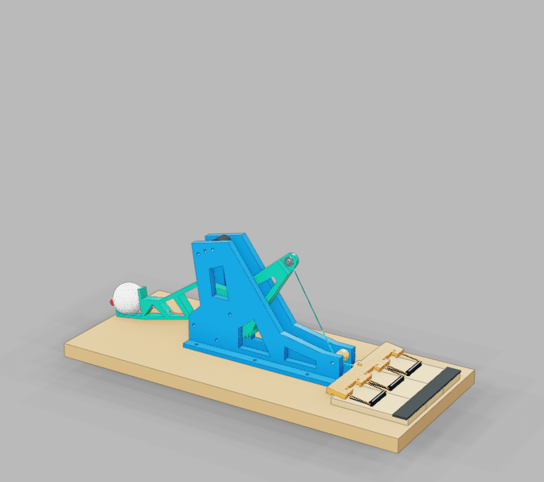
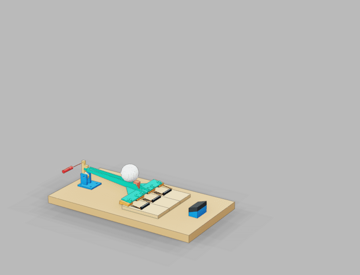

# MTC-180 (`v5` Floor-Flush) — Rubric-Compliant 3-Mousetrap Cord-Driven Golf-Ball Catapult



Parametric [Cadpole](https://github.com/halbritt/cadpole) CAD and [CalculiX 2.23](http://www.dhondt.de/) `C3D8I` two-phase FDM PETG finite-element model engineered for strict compliance with *The Mousetrap Catapult* rubric (`Design #1–#7`, `Materials #1–#2`) and verified against `IMG_4479.jpg` physical spring-clearance photometry:

1. **100% Floor-Flush Flat Base (`Design #4` & `#5`):** Single `450 × 204 × 18.0 mm` (`17.7" × 8.0" × 0.71"`, **`≤ 1"`**) plywood board sitting dead flush on the floor inside the **`2' × 2'`** launch box (`19.4"` diagonal << `3 ft` max diameter). All three stripped Victor mousetraps screw **right-side up and dead flat (`0.00°`)** onto the base (`springs 100% unaltered`).
2. **Photometry-Verified Torsion-Spring Clearance (`IMG_4479.jpg`):** Calibrated at `21.64 px/mm`, each Victor trap's black torsion-spring moving leg crosses over the left copper bail wire (`Y = yc - 19.35 mm`) and terminates at **`X = 25.7 mm, Y = yc - 21.2 mm`**. Starting `cad/bail_coupler.star` at **`X_MIN = 28.50 mm`** provides **`> 2.8 mm` axial clearance** on all three traps (`assert_true(ds.distance > 2.0)` across all 8 poses) while keeping solid `1.52 mm` driven-side PETG floors under all six `38.70 mm` C-to-C wires.
3. **Cord-and-Horn Linkage + `< 3"` Ball Height:** A braided non-stretch cord runs from the `16.3 cm³` 3-bail coupler (`R_PULL = 50.8 mm`) under a free-spinning `M4` V-roller (`(34, 39) mm`) to an `M4` cord post on the throwing arm's horn (`104 mm` from the pivot, `L_BALL = 170.0 mm`). The cord does not wrap anything on the arm. Both ends are cranks, and the horn reaches dead centre (post, pivot and roller in line) `2°` past the `42°` stop, so the bails are slowed to a halt as the arm reaches full speed and hand their own kinetic energy to the arm. At full cock (`notch 6`) the cord holds the bails at `165°`; they are at `39°` when the arm stops, still on a taut cord. `cad/linkage.star` holds the exact cord kinematics used by the assembly; `mise run camsim` is the launch model.
   - **Why not a cam:** the earlier `R = 98 mm` circular cam needed the bails to keep paying out cord at a constant rate, but the cord's lever arm about the trap hinge collapses over the last `50°` of bail travel (`43 mm` at `90°`, `22 mm` at `40°`, `5 mm` at `7°`). In the same model the cam's cord goes slack with the bails at `53°`, and that design reaches `5.2 m/s` (`2.9 m`), not the `7.4 m/s` previously stated. It also only wound the bails to `156°`, not `173°`.
   - **Cocked ball bottom height:** **`30.7 mm` (`1.21 inches` — `< 3.00 inches` rubric limit)** in an open top-loading `45°` V-cradle (`~0.5 s` drop-in reload for `6–8 balls` in `< 90 s`).
   - **Center-of-Percussion Stop Sleeve (`42° / 50°` quick-pin holes):** `Ø14.4 mm` PETG core wrapped with `3 mm` rubber (`Ø20.4 mm` OD) catches the upper truss chord near its center of percussion with `> 83 mm` ball flight clearance.
4. **Zero Rubber Bands — 6-Notch Range Quadrant + Gravity Ratchet Sear (`Design #6`, Day 2 Accuracy):** A counterweighted 1-piece PETG sear pawl (`cad/stanchion_trigger.star`) pivots on an `M4` bolt with **gravity alone** tipping its tooth into **6 calibrated range notches** (range table below), tripped from behind by a braided pull-string (the tooth carries about `79 N` at full cock; measure the pull on the first print).
5. **100% `M4` Hardware (`Zero M3 Needed`):** Uses `M4` washers + self-tapping `M4 × 6–8 mm` screws on the 3-bail coupler, `1×` `M4 × 8 mm` screw + washer for the horn's cord post, `4×` `M4 × 45–50 mm` bolts/pins through the stanchion bores (arm pivot, cord roller, sear pawl, and 2-angle stop sleeve), and `#6` / `M4` wood screws into the `3/4"` plywood board.

## Alternative: Direct-Drive Rail Arm (arm bolted straight to the three traps)



A second, simpler build that shares the same base, flat traps and `mtc180_bail_coupler`: instead of the cord, horn arm, pivot and stanchions, a 30 g rail arm (`cad/direct_arm.star`) bolts directly onto the coupler's flat driven face with the same six `M4` screws (use `M4 × 10` instead of `× 6–8`).

**Why it is not a cup.** With the traps flat on a floor-flush base the arm can only swing in the half-plane above the floor. A ball held rigidly on such an arm is moving *upward* only while the arm is behind vertical, so it must be released in roughly the first 60° of the 166° stroke; in the model that tops out near 2.3 m. This arm instead lets the ball **roll outward along two rails** while the bails swing. The outward speed adds to the tangential speed, so the ball leaves the tip heading about 35° upward when the arm is vertical, after about 85° of stroke. In the models the ball gets about 0.8 J here against about 1.0 J from the cord-and-horn arm, so expect roughly 75% of that design's `~4.8 m` carry.

| Backstop hole | Ball start radius | Release (arm angle / elevation / speed) | Model carry (rolling) | Carry if the ball slides | Carry at −20% / +20% spring energy |
| --- | --- | --- | --- | --- | --- |
| **1A (max — Day 1)** | `80 mm` | `88° / 35° / 5.9 m/s` | **`3.7 m`** | `3.4 m` | `2.9 m` / `4.4 m` |
| 2A | `91 mm` | `95° / 39° / 5.7 m/s` | `3.5 m` | `3.0 m` | `2.8 m` / `4.2 m` |
| 3A | `101 mm` | `101° / 43° / 5.5 m/s` | `3.3 m` | `2.6 m` | `2.6 m` / `3.9 m` |
| 5A | `122 mm` | `113° / 50° / 5.0 m/s` | `2.7 m` | `1.8 m` | `2.1 m` / `3.2 m` |
| 7A | `143 mm` | `125° / 57° / 4.5 m/s` | `1.9 m` | `1.2 m` | `1.5 m` / `2.3 m` |
| 9A | `164 mm` | `138° / 65° / 3.9 m/s` | `1.1 m` | `0.6 m` | `0.9 m` / `1.4 m` |

*(`mise run sim` prints all 20 positions. These are model numbers: the spring energy (`2.12 J` for three traps) and its torque curve are assumed, not measured, and nothing here has been printed or fired. Calibrate the table on the real machine before Day 2.)*

- **Day 2 adjustment:** the ball rests against a small backstop block between the rails. Ten holes at 10 mm pitch, and the block's off-centre screw gives 5 mm half-steps when turned round ("A"/"B"), so each step moves the landing point by about 0.1–0.2 m. Moving the ball outward shortens and steepens the throw.
- **Loading:** cock the arm back flat (173°), swing the hook sear over the tongue ridge, then drop the ball on the rails; they slope 3° toward the hinge when cocked, so the ball seats itself against the backstop. Cocked ball bottom is about 55 mm (2.2") off the floor, inside the 3" rule.
- **Trigger (`cad/direct_trigger.star`):** a C-hook on an `M4` bolt in a clevis bracket screwed to the base under the arm tip. Latch load is about 4.5 N and passes almost through the pivot; pull the string rearward to fire.
- **Stop:** after the ball leaves, the bare arm keeps accelerating and reaches the stop with about 0.9 J (tip speed around 14 m/s). It lands at 14° on a printed wedge carrying a **10 mm soft foam pad** near the arm's centre of percussion. Keep fingers out of the arc.
- **Parts:** `exports/direct/mtc180_direct_arm_h2s.3mf` (arm, 23.7 cm³) and `exports/direct/mtc180_direct_kit_h2s.3mf` (backstop, hook, bracket, stop wedge, 26.7 cm³), plus the existing bail coupler. Extra hardware: `6× M4 × 10` (coupler + arm), `1× M4 × 10` (backstop), `1× M4 × 25` bolt + nut (sear pivot), `6×` wood screws.
- **Checks:** `cad/print_direct_arm.star`, `cad/print_direct_kit.star` and `cad/installed_direct.star` (10-pose rubric, spring-clearance, sear, stop and ball-path sweep) run under `mise run test`.

## Repository Layout & Verification Commands

- `cad/bail_coupler.star` & `cad/print_bail_coupler.star` — Spring-cleared (`X >= 28.5 mm`) driven-side 3-bail coupler (`16.28 cm³` CAD, `6× M4` washer locks).
- `cad/throwing_arm.star` & `cad/print_throwing_arm.star` — Monolithic throwing arm (cord horn with `M4` cord post + `6-notch` sear quadrant + self-centering `45°` V-cup + centrifugal backstop).
- `cad/stanchion_trigger.star` & `cad/print_stanchion_kit.star` — Left/right mirrored A-frame stanchions (`42°/50°` CoP stop holes), stop sleeve, `M4` V-roller, and counterweighted gravity sear pawl.
- `cad/linkage.star` — Exact drive-cord kinematics (eye → roller → horn post) shared by the assembly.
- `cad/installed_floorflush.star` — Full 8-pose rubric, cord-path & `IMG_4479` spring-clearance test suite + 64-frame launch animation.
- `analysis/cam_launch_sim.py` — Launch model for the cord linkage (taut/slack cord, bail and arm inertia); prints the range table.
- `cad/direct_arm.star`, `cad/direct_trigger.star`, `cad/installed_direct.star`, `analysis/direct_arm_sim.py` — Direct-drive rail-arm alternative (arm bolted to the coupler) and its launch model.
- `fea/run_floorflush_fea.py` — CalculiX 2.23 `C3D8I` two-phase FDM (`PETG_SHELL` + `PETG_GYROID15`) solver.

```sh
mise run test       # Run all 11 Cadpole H2S 3-nozzle printability, spring-clearance (>2mm), and rubric checks
mise run export     # Rebuild exports/*.stl, *.3mf, *.pdf, *.svg
mise run animate    # Rebuild 64-frame floor-flush animated launch GIF
mise run fea        # Run CalculiX 2.23 C3D8I two-phase FDM stress & inertia study
mise run camsim     # Cord-linkage launch model: range table and sensitivities (--cam 96.5 --th-cock 156 = the old cam)
```

## CalculiX 2.23 `C3D8I` FEA (`v5`, `20,821` Coupler + `18,150` Arm Bricks)

| Component / Load Case (`mise run fea`) | Verified Result (`Two-Phase FDM PETG`: `1.8 mm` Shell + `15%` Gyroid) |
| --- | --- |
| **3-Bail Coupler (`16.28 cm³`, `140 N` peak cord pull)** | $I_{\text{coupler}} = 0.319\text{ kg·cm}^2$, $U_{\max} = 0.21\text{ mm}$, $\sigma_{\text{VM},99.8\%} = 6.44\text{ MPa}$ |
| **Throwing Arm (`101.37 cm³`, `64 g` in the two-phase model, `L = 170 mm`)** | $I_{\text{arm}} = 4.686\text{ kg·cm}^2$, $v_0 = 6.72\text{ m/s}$ from the linkage model (**`~4.8 m` carry at `42°`**) |
| **Arm LC1: Launch Drive (`60 N` cord pull square to the horn, `2×` static full cock)** | $\sigma_{\text{VM},99.8\%} = 3.43\text{ MPa}$ |
| **Arm LC2: CoP Padded Stop Sleeve (`Ø20.4 mm` OD, `380 N/mm` rubber)** | $\sigma_{\text{VM},99.8\%} = 11.99\text{ MPa}$ (`4.2×` safety factor to `50 MPa` PETG yield) |
| **Arm LC3: Full-Cock Ratchet Tooth #6 Standby (`29 N` cord)** | $\sigma_{\text{VM},99.8\%} = 1.34\text{ MPa}$ (`75 N` tooth compression into gravity sear) |

## Day 1 Max Distance & Day 2 Accuracy Range Table (model, `mise run camsim`)

| Ratchet Sear Notch | Arm Cock Angle (`ψ_cock`) | Bail Windup (`θ_bail`) | `42°` hole: speed / carry | `50°` hole: speed / carry |
| --- | --- | --- | --- | --- |
| **Notch #6 (`MAX` — Day 1)** | `-6.7°` (`ball 1.21" off floor`) | `165°` | `6.7 m/s` / **`4.8 m`** | `5.8 m/s` / `3.5 m` |
| **Notch #5** | `+2.2°` | `144°` | `6.0 m/s` / **`3.9 m`** | `5.1 m/s` / `2.7 m` |
| **Notch #4** | `+11.2°` | `126°` | `5.4 m/s` / **`3.1 m`** | `4.4 m/s` / `2.1 m` |
| **Notch #3** | `+19.6°` | `108°` | `4.7 m/s` / **`2.5 m`** | `3.8 m/s` / `1.6 m` |
| **Notch #2** | `+28.0°` | `89°` | `3.9 m/s` / **`1.8 m`** | `2.9 m/s` / `1.0 m` |
| **Notch #1 (Short)** | `+35.8°` | `69°` | `3.0 m/s` / **`1.1 m`** | `1.7 m/s` / `0.4 m` |

- These are model numbers. The spring energy (`2.12 J` for three traps over `180°`) and its torque curve are assumed, not measured, and nothing here has been printed or fired. With the springs `20%` weaker the full-cock carry is `3.8 m`; `20%` stronger, `5.8 m`. Calibrate the table on the real machine before Day 2.
- The `50°` hole is not a fine trim: it stops the arm `10°` before the horn's dead centre, which costs about `1 m/s` as well as steepening the launch. There is no `34°` hole, because the arm cannot usefully pass dead centre.
- **Tying the cord:** with the arm resting on the `42°` stop, push the arm down into notch 6 and tie the loop on the horn post so the bails sit `15°` short of flat on the traps (`165°`). The model is not sensitive to this: `±2 mm` of cord changes the carry by less than `0.1 m`. A cord that is too short will not let the arm reach notch 6.
- **Rubric check for Day 2:** the ball is within `3"` of the floor only at notch 6 (and close to it at notch 5). Loaded at a higher notch it starts above `3"`; confirm with the teacher how that rule is applied before relying on notches 1–4.

## Bambu Lab H2S Print Plates (PETG, Supports OFF, Arachne ON, 15% Gyroid)

| Plate (`exports/*_h2s.3mf`) | Recommended Nozzle | Layer × Width | PETG Mass | Extrusion Time |
| --- | --- | --- | --- | --- |
| **1. `mtc180_bail_coupler` (`16.3 cm³` — Print & Test-Fit First)** | `0.6 mm` TC / `0.8 mm` TC | `0.40 × 0.88 mm` (`2` walls) | **`~12 g`** | **`~5.5 min`** |
| **2. `mtc180_throwing_arm` (`101.4 cm³` — 14 mm Truss + Cord Horn)** | `0.6 mm` TC / `0.8 mm` TC | `0.40 × 0.88 mm` (`2` / `3` walls) | **`~58 g`** (scaled from the `125.5 cm³` slice, not re-sliced) | **`~26 min`** (scaled) |
| **3. `mtc180_stanchion_kit` (`268.2 cm³` — 5 Parts)** | `0.6 mm` TC / `0.8 mm` TC | `0.40 × 0.88 mm` (`2` walls) | **`~145 g`** | **`~62 min`** |

## Hardware BOM (100% `M4` — Zero `M3`, Zero Rubber Bands)

- **Wood Base:** `1×` `450 × 204 × 18 mm` (`17.7" × 8.0" × 3/4"`, `≤ 1"`) flat plywood board.
- **Mousetraps:** `3×` standard Victor mousetraps (`46.1 × 98.4 mm`; strip only the bait pedal and loose trigger wire — leave all springs and spring-anchoring staples untouched), screwed flat (`0.00°`) side-by-side at `X = 62.8..161.2 mm`.
- **3-Bail Coupler Locks:** `6×` `M4 × 6–8 mm` screws + `6×` `M4` fender washers (`9–12 mm` OD) into the self-tapping `Ø3.5 mm` bosses (C-jaw snap lips + spring preload also hold the wires screwless for initial test fits).
- **Cord Post:** `1×` `M4 × 8 mm` screw + `1×` `M4` fender washer (`≤ 12 mm` OD) into the `Ø3.5 mm` pilot at the horn tip; the cord loop turns on the printed collar under the washer.
- **Stanchion Axles & Mounting:** `4×` `M4 × 35–45 mm` bolts/pins (arm pivot, front cord roller, gravity sear pivot, and quick-pin CoP stop sleeve) + `6×` `M4` or `#6` wood screws through the outboard stanchion L-flanges into the plywood base.
- **Cord & Cushioning:** Non-stretch braided Dacron/nylon cord (`~250 mm` drive cord + `~300 mm` rear trigger string) and `3 mm` adhesive rubber/foam strip on the CoP stop sleeve and front bail landing pad.
