> **v4 note (2026-11-22):** the sections below were written for earlier carrier revisions. The current geometry — driven-side wire seats, recessed washer locks, cup backstop wall, stop block and safety-pin yoke — is described in the top-level `README.md`. Figures quoted below for mass, exit speed and stop shock predate v4.

# MTC-180L-PL Caliper-Exact FEA-Optimized PETG 3-Mousetrap Carrier (38.70 mm C-to-C × 43.2 mm Bail, Bambu H2S)

## Printable Part & Interactive 3D Deliverables (`MTC-180L-PL` Caliper-Exact Positive-Lock PETG)

- **Recommended (`MTC-180L-PL` v3.1 Caliper-Exact Carrier + Distal Sear D-Loop — `~45 g` PETG, `~20 min` on H2S `.6 TC`):**
  - **Full-Mechanism + Trigger Pull + Ball Launch GIF:** [**Watch `mtc180_full_mechanism_launch.gif`**](https://artifact.harm.org/8jtvrt/mtc180_full_mechanism_launch.gif) · *(Earlier carrier-only GIF: [`mtc180_180deg_launch.gif`](https://artifact.harm.org/3d1y54/mtc180_180deg_launch.gif))*
  - **Interactive 3D Viewer:** [Full Triggered Wood-Board Assembly (Flat-Mounted Traps)](https://3dviewer.harm.org/#model=https://3dviewer.harm.org/models/5tg10k/mtc180_triggered_assembly.glb) · [3-Part Trigger Kit](https://3dviewer.harm.org/#model=https://3dviewer.harm.org/models/dzgs4h/mtc180_trigger_kit.glb) · [Carrier v3](https://3dviewer.harm.org/#model=https://3dviewer.harm.org/models/3hgdg2/mtc180_positivelock_petg.glb)
  - **Carrier v3.1 + Trigger Kit Bundle ([`bundle.zip`](https://artifact.harm.org/0tq7z7/_artifact/bundle.zip) · [All Files](https://artifact.harm.org/0tq7z7/_artifact/)):** Carrier H2S 3MF [`mtc180_positivelock_petg_h2s.3mf`](https://artifact.harm.org/0tq7z7/mtc180_positivelock_petg_h2s.3mf?download=1) · Carrier STL [`mtc180_positivelock_petg.stl`](https://artifact.harm.org/0tq7z7/mtc180_positivelock_petg.stl?download=1) · Carrier A3 [`PDF`](https://artifact.harm.org/0tq7z7/mtc180_positivelock_petg_drawing.pdf) · **Trigger Kit H2S 3MF** [`mtc180_trigger_kit_h2s.3mf`](https://artifact.harm.org/0tq7z7/mtc180_trigger_kit_h2s.3mf?download=1) · **Trigger Kit STL** [`mtc180_trigger_kit.stl`](https://artifact.harm.org/0tq7z7/mtc180_trigger_kit.stl?download=1) · **Trigger Kit 1:1 A3 [`PDF`](https://artifact.harm.org/0tq7z7/mtc180_trigger_kit_drawing.pdf)**
- **Fast 1:1 Crossbar Bail-Fit Verification Coupon (`X = 19.5..60.0 mm`, `40.5 × 146.5 × 8.2 mm` — Physically Test-Fit Verified):**
  - **Interactive 3D Viewer:** [Open 1:1 Crossbar Fit Coupon](https://3dviewer.harm.org/#model=https://3dviewer.harm.org/models/8zr17w/mtc180_crossbar_fit_coupon.glb)
  - **Print & 1:1 Drawing Files ([`bundle.zip`](https://artifact.harm.org/qjkz4w/_artifact/bundle.zip) · [All Files](https://artifact.harm.org/qjkz4w/_artifact/)):** 1:1 A3 Drawing [`PDF`](https://artifact.harm.org/qjkz4w/mtc180_crossbar_fit_coupon_drawing.pdf) · Bambu H2S 3MF [`mtc180_crossbar_fit_coupon_h2s.3mf`](https://artifact.harm.org/qjkz4w/mtc180_crossbar_fit_coupon_h2s.3mf?download=1) · Coupon STL [`mtc180_crossbar_fit_coupon.stl`](https://artifact.harm.org/qjkz4w/mtc180_crossbar_fit_coupon.stl?download=1)

````carousel
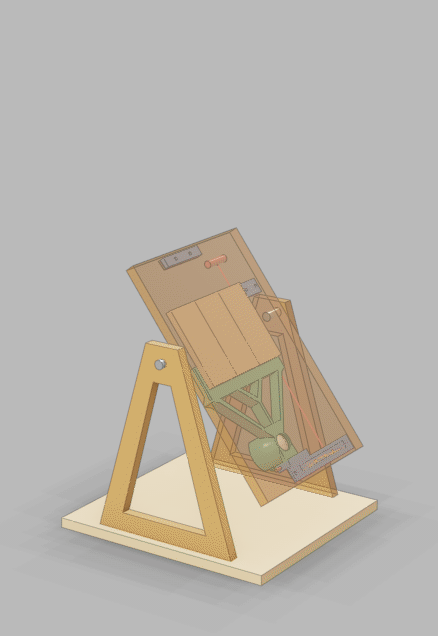
<!-- slide -->
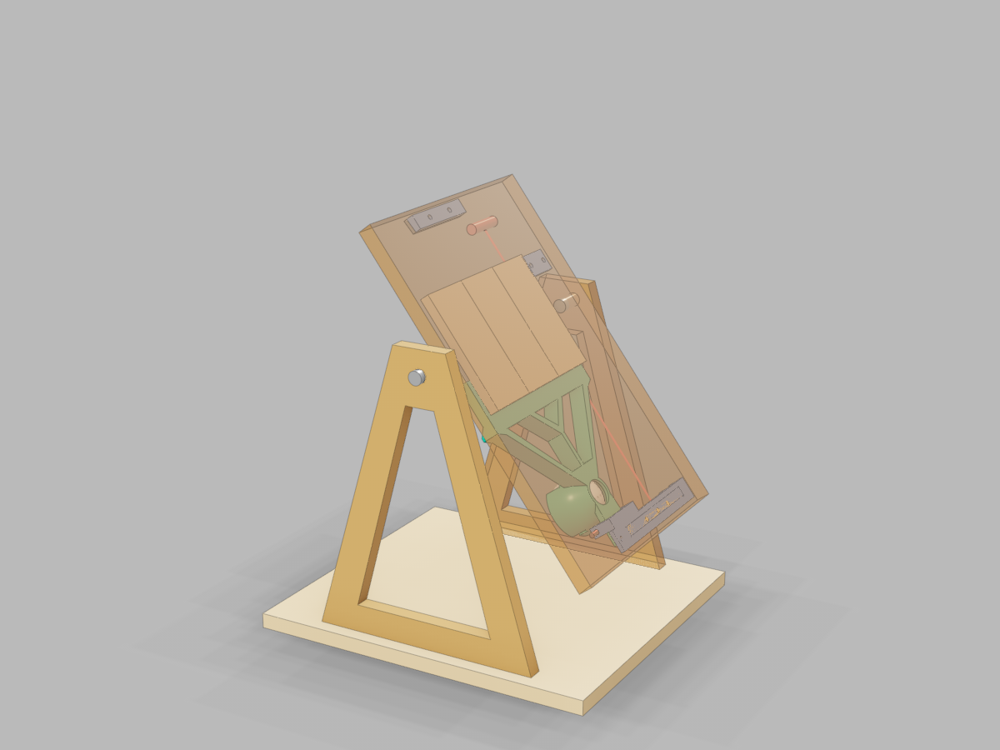
<!-- slide -->
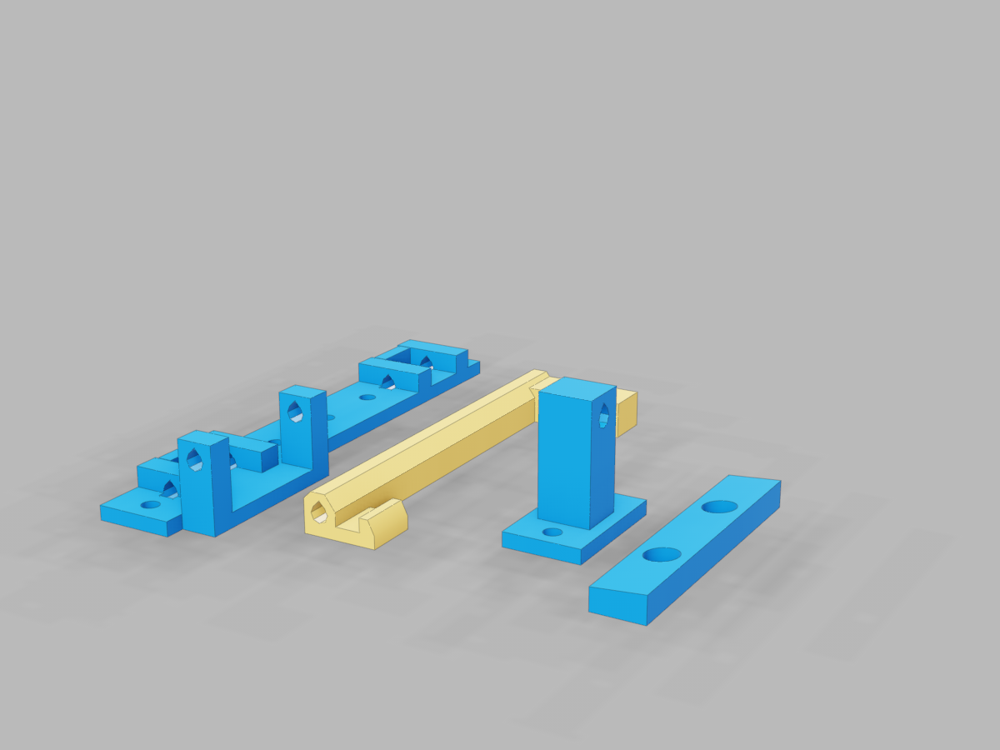
<!-- slide -->
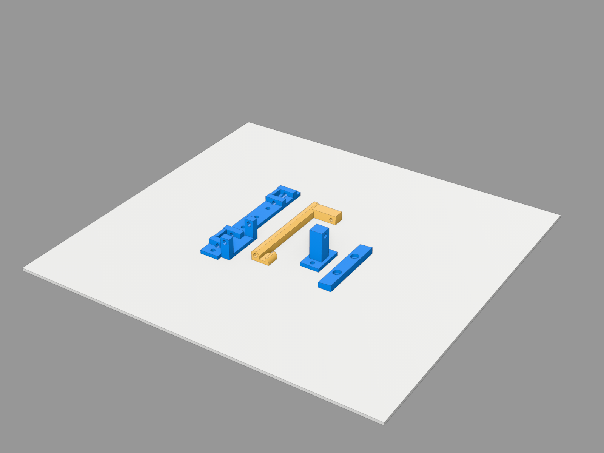
<!-- slide -->
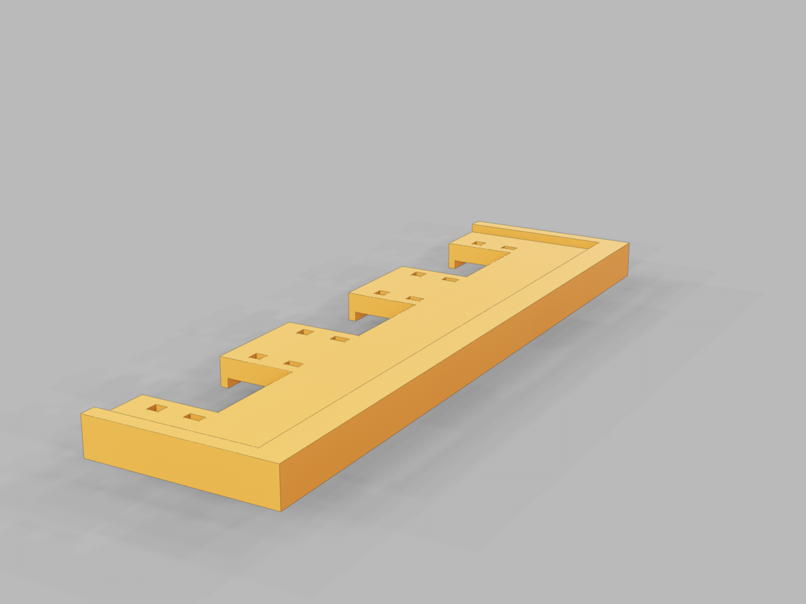
<!-- slide -->
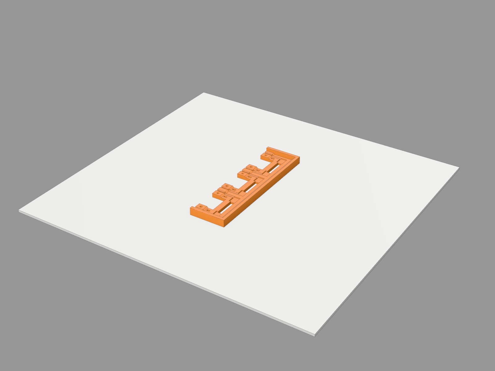
<!-- slide -->
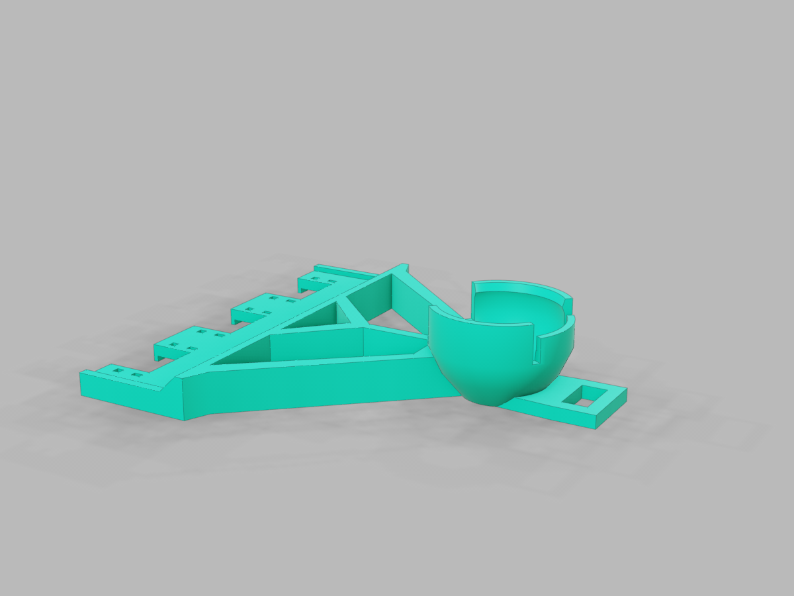
<!-- slide -->
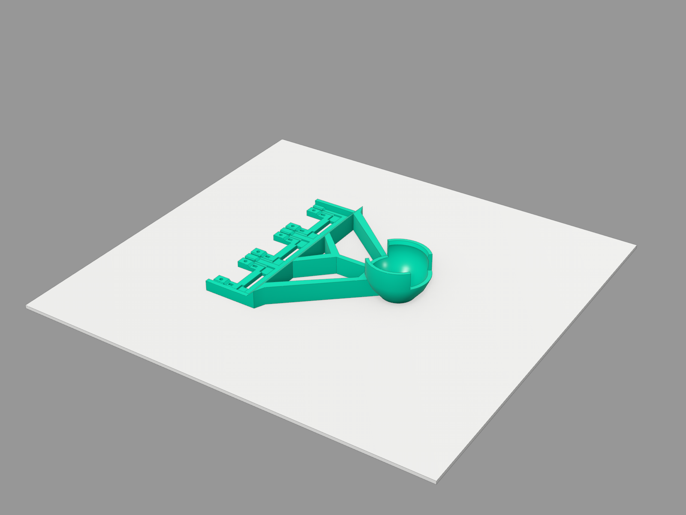
<!-- slide -->
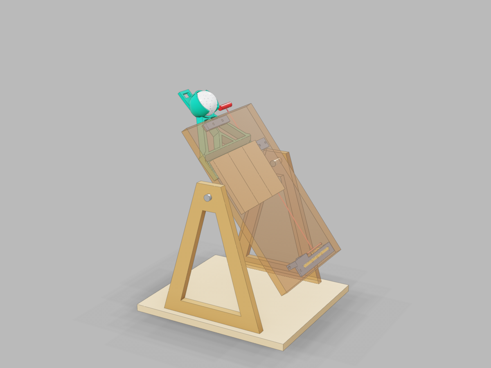
<!-- slide -->
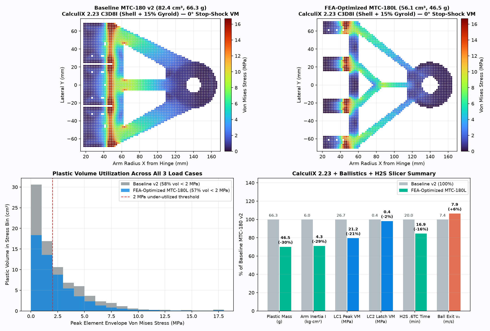
<!-- slide -->
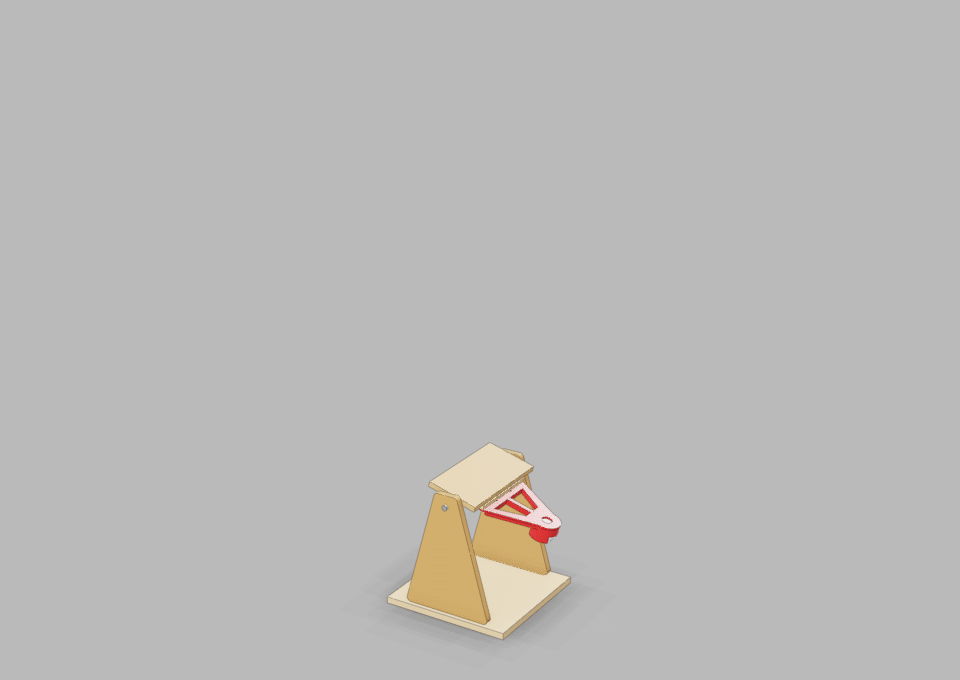
````

---

## 1. How the Single 3D-Printed Part Solves all Three 180° Constraints

1. **Zero-Clearance Loss at Both $180^\circ$ (Cocked) and $0^\circ$ (Snapped):**
   - On a regulation Victor M040 mousetrap ($98.4 \times 46.0 \times 8.0\text{ mm}$ wood base, $\varnothing 1.80\text{ mm}$ wire U-bail, $R_{\text{bail}} = 47.5\text{ mm}$, spring coil center $3.5\text{ mm}$ off the wood), any thick clamp block inside $r < 49.2\text{ mm}$ hits the wooden base before reaching $0^\circ$ or $180^\circ$.
   - The `MTC-180 v2` carrier keeps the three U-bail attachment tongues (`Y = -46.5, 0.0, +46.5 mm`, `44.3 mm` tongue width) to **$3.8\text{ mm}$ total thickness** inside $X \in [18.0, 51.2]\text{ mm}$, with **self-centering $38.0\text{ mm}$ center-to-center flared V-grooves** ($2.7\text{ mm}$ top throat tapering to $0.6\text{ mm}$ floor at `Z = 1.85..3.80 mm`, accepting $37.2\text{--}38.8\text{ mm}$ wire spacing) plus a **coplanar $4.9\text{ mm}$ front crossbar relief pocket** (`X = 45.6..48.6 mm` floor) so front-to-back bail length tolerances never bind the side wires.
   - Immediately past the $49.2\text{ mm}$ end of the wooden mousetrap bases ($X \ge 51.4\text{ mm}$), the collector crossbar and triangulated A-frame truss ribs step up to **$10.5\text{ mm}$ depth** with zero wood interference.
2. **Upside-Down Standby Retention + Zero-Snag Tangential Release:**
   - Rotating any rigid cup $180^\circ$ to point upward at $+\gamma$ at release means its mouth points downward at $-\gamma$ when cocked at $180^\circ$.
   - The `MTC-180` cup ($X_{\text{ball}} = 140.0\text{ mm}$, $\varnothing 43.7\text{ mm}$ ID barrel, $\varnothing 19.0\text{ mm}$ anti-suction bottom vent) cuts $\pm 40^\circ$ front/rear pie reliefs to form **two compliant side cantilever petals** ($t = 2.55\text{ mm}$). At $Z = 29.0\text{ mm}$ ($+6.0\text{ mm}$ above the seated ball center $Z = 23.0\text{ mm}$, where ball chord radius is $20.47\text{ mm}$), a $22^\circ$ inward ramp narrows the throat to $r = 20.95\text{ mm}$ ($0.385\text{ mm}$ radial deflection against the $21.335\text{ mm}$ ball equator).
   - This produces **$3.5\text{ N}$ ($7.8\,g$) static snap-in retention**—holding the $45.93\text{ g}$ golf ball upside-down at $180^\circ$ with zero rattle while seated—yet consumes only $0.004\text{ J}$ ($0.17\%$ of spring energy) when $>200\text{ N}$ stop-impact inertia ejects the ball straight out along $+\hat{e}_\theta$.
3. **Zero-Support Flat FDM Printability (`cadpole check`: 0 warnings):**
   - Because the tangential launch axis $+\hat{e}_\theta$ is perpendicular to the arm plane, printing the part flat on `Z = 0` aligns all perimeter extrusions continuously along the bending axis of the arm (tensile strength $\sim 50\text{ MPa}$ along filaments, never across layer lines) while orienting the golf-ball cup upright with a $45^\circ$ self-supporting conical-spherical seat.

---

## 2. Trajectory Control via Mousetrap Base Angle

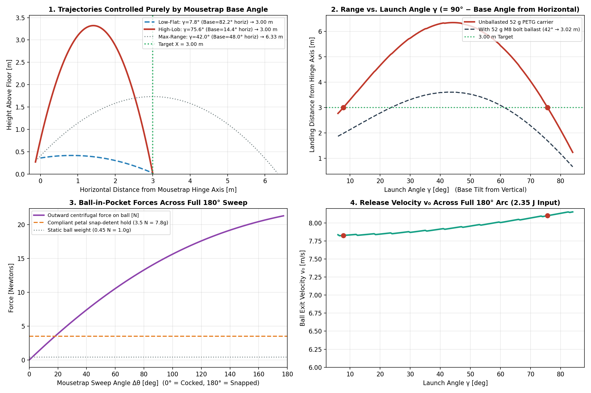

When the three mousetraps are mounted on the **underside** of a $95\text{ mm}$-long tilted cradle plate (supported outboard at $Y = \pm 98\text{ mm}$ at trunnion height $Z_{\text{pivot}} = 215\text{ mm}$ so the $148.2 \times 132.8 \times 32.0\text{ mm}$ carrier sweeps underneath with $>50\text{ mm}$ floor clearance), the launchvelocity vector $\vec{v}_0$ at the end of the $180^\circ$ sweep is perpendicular to the mousetrap wooden bases:

$$\gamma_{\text{launch}} = 90^\circ - \beta_{\text{horiz}}$$

where $\beta_{\text{horiz}}$ is the tilt angle of the mousetrap base measured from horizontal (snap-shut end up-and-rearward, cocked end down-and-forward). Across the full $180^\circ$ sweep ($2.35\text{ J}$ elastic input, $52\text{ g}$ printed carrier mass), the unballasted carrier reaches $6.33\text{ m}$ at $\gamma = 42^\circ$, giving two exact base-angle settings for **$3.00\text{ m}$** with zero hardware changes—plus an optional $42^\circ$ setting if $52\text{ g}$ of M8 bolt/nut ballast is added to the front truss boss:

| Trajectory Mode | Mousetrap Base Tilt from Horizontal ($\beta_{\text{horiz}}$) | Resulting Launch Angle ($\gamma$) | Exit Speed ($v_0$) | Trajectory Apex | Landing Distance from Hinge Axis |
| --- | --- | --- | --- | --- | --- |
| **High-Lob Mortar (Unballasted)** | **$14.4^\circ$** | **$75.6^\circ$** | $8.10\text{ m/s}$ | $3.21\text{ m}$ | **$3.00\text{ m}$** |
| **Low-Flat Line Drive (Unballasted)** | **$82.2^\circ$** | **$7.8^\circ$** | $7.83\text{ m/s}$ | $0.42\text{ m}$ | **$3.00\text{ m}$** |
| **Max Distance (Unballasted)** | $48.0^\circ$ | $42.0^\circ$ | $7.93\text{ m/s}$ | $1.74\text{ m}$ | $6.33\text{ m}$ |
| **Mid-Arc (+52 g M8 Bolt Ballast)** | $66.2^\circ$ / $29.8^\circ$ | $23.8^\circ$ / $60.2^\circ$ | $6.02\text{ m/s}$ | $0.58\text{ m}$ / $1.62\text{ m}$ | **$3.00\text{ m}$** |

---

## 3. CalculiX 2.23 FEA Optimization & Bambu Lab H2S Print Times

### Two-Phase FDM (`PETG_SHELL` + `PETG_GYROID15`) CalculiX 2.23 `C3D8I` Verification
Modeled in CalculiX 2.23 (`ccx` incompatible-modes `C3D8I` bending elements: `32,734` bricks on `v2`, `25,037` bricks on `MTC-180L`) with explicit two-phase FDM properties ($E = 2{,}100\text{ MPa}, \nu = 0.38, \rho = 1.27\text{ g/cm}^3$ in the outer $1.80\text{ mm}$ solid shell; $E = 160\text{ MPa}, \rho = 0.19\text{ g/cm}^3$ in the $15\%$ gyroid core):

| Metric | Baseline `v2` (`82.4 cm³`) | **`MTC-180L` Strengthened (`56.1 cm³`)** | **`MTC-180L-FW` Featherweight (`40.0 cm³`)** |
| --- | --- | --- | --- |
| **Two-Phase FDM Mass / `.6 TC` Sprint Mass** | `66.3 g` / `45.8 g` | **`46.5 g` / `37.7 g` (`-30%`)** | **`33.6 g` / `31.7 g` (`-49%`)** |
| **Rotational Inertia $I_{\text{arm}}$ (about `X=0`)** | `5.982 kg·cm²` | **`4.252 kg·cm²` (`-28.9%`)** | **`3.159 kg·cm²` (`-47.2%`)** |
| **Stop-Impact Kinetic Energy $KE_{\text{stop}}$** | `0.846 J` | **`0.680 J` (`-19.6%`)** | **`0.551 J` (`-34.9%`)** |
| **Golf-Ball Exit Speed $v_0$** | `7.45 m/s` | **`7.92 m/s` (`+6.3%`)** | **`8.27 m/s` (`+11.0%`)** |
| **LC1: Equal `25 N` Launch Seat Deflection / VM** | `2.71 mm` / `6.64 MPa` | **`1.96 mm` (`+38%` stiffer) / `5.43 MPa` (`-18%`)** | `2.31 mm` / `5.85 MPa` |
| **LC2: `0°` Stop-Shock VM ($99.8\%$) / Interlayer $S_{zz}$** | `26.70 MPa` / `8.99 MPa` | **`21.22 MPa` (`-20.5%`) / `5.69 MPa` (`-36.7%`)** | `19.71 MPa` / `5.36 MPa` |
| **LC3/4: `48 N` Latch VM / `0.42 mm` Petal Snap VM** | `0.39 MPa` / `12.25 MPa` | **`0.38 MPa` / `11.75 MPa`** | `0.51 MPa` / `17.25 MPa` |

### Bambu Lab H2S Nozzle Comparison on `MTC-180L` (`mtc180_ultralight_petg_h2s.3mf`)
Verified zero-warning (`cadpole test`) across `0.4`, `0.6`, and `0.8 mm` nozzles on `printer="bambu_h2s"` (`5/5` 180° arc clearance checks passed; Supports **OFF**, Arachne ON, **15% gyroid**, height-range modifier `Z = 18.0..32.0 mm` for solid `2.65 mm` compliant petals):

| H2S Nozzle | Layer × Line Width | Walls (`Base` / `Z≥18`) | PETG Mass (`MTC-180L-PL`) | Extrusion Time | Wall-Clock (+H2S Prep) |
| --- | --- | --- | --- | --- | --- |
| **`0.6 mm` TC (Sprint — Recommended)** | **`0.40 × 0.88 mm`** | **`2` / `3`** | **`43.3 g`** (`31.7 g` FW) | **`19.1 min`** (`14.3 min` FW) | **`~24.6 min`** (`~19.8 min` FW) |
| **`0.8 mm` TC (AdaptTop `0.24` @ `Z≥25.5`)** | `0.44 × 0.90 mm` | `2` / `3` | `46.2 g` (`32.3 g` FW) | **`19.9 min`** (`14.5 min` FW) | **`~25.4 min`** (`~20.0 min` FW) |
| **`0.4 mm` HF** | `0.28 × 0.56 mm` | `3` / `5` | `43.0 g` (`31.2 g` FW) | **`23.3 min`** (`17.6 min` FW) | **`~28.8 min`** (`~23.1 min` FW) |
| **`0.4 mm` Standard (Stock)** | `0.20 × 0.42 mm` | `4` / `5` (25%) | `48.2 g` (`33.6 g` FW) | `52.5 min` (`40.6 min` FW) | `~58.0 min` (`~46.1 min` FW) |

### Caliper-Exact Positive-Lock Attachment (`46.1 × 98.4 mm` Base, `40.5 × 43.2 mm` `Ø1.8 mm` Bail)
1. **Prep Traps:** Remove the bait pedals and hold-down bars from three traps and butt the **`46.1 × 98.4 mm` wooden bases dead flush edge-to-edge** (`46.15 mm` pitch = `138.3 mm` pack width, zero shims needed) under the $95 \times 196\text{ mm}$ tilting cradle plate. The carrier's two `8.2 mm` outboard edge girders (`|Y| = 69.85..73.25 mm`) straddle outside the `138.3 mm` wood pack and clear the mounting board by `>3 mm`.
2. **Hook `43.2 mm` Crossbars & Click Into `38.70 mm` C-to-C Snap-Jaws:** Drop the three front wire crossbars (`X = 43.20..45.00 mm`) into the `5.0 mm` open drop-through slots (`X = 42.30..47.30 mm`, joined to the side grooves via front corner-turn reliefs) so the solid `6.1 mm` bail-retainer webs (`X = 36.20..42.30 mm`) sit **inside** each closed U-bail. Press the six straight side wires (**`40.5 mm` OD = `38.70 mm` C-to-C**) past the `1.44 mm` snap throats (`X = 18.5..28.8 mm`) until they click into the octagonal `Ø1.96 mm` seats. Inside `|Y| <= 69.2 mm` and `X <= 51.6 mm`, the carrier steps down to `Z = 3.20 mm` so the `45.0..49.2 mm` wood tip clears at `0°` and bare steel strikes the wood.
3. **Lock Rear M3 Clamps (`X = 24.2 mm`):** Thread **6× `M3 × 6–8 mm` low-head screws + `0.5 mm` M3 washers** into the inboard `Ø2.66 mm` self-tapping bosses (`Y = ±15.0, ±31.15, ±61.15 mm`, leaving the inter-trap girders 100% un-drilled), or run flat-head M3 screws from the flush `45°` `Z = 0` countersinks into [`m3_wire_clamp_bars.stl`](https://artifact.harm.org/e2zrve/m3_wire_clamp_bars.stl?download=1).
